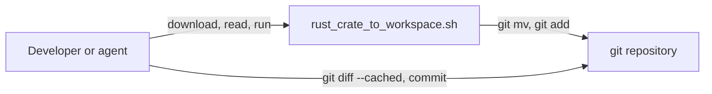

# Architecture of rust_crate_to_workspace

Reviewed against the code on 2026-11-28.

## Context

A developer (or an agent) downloads `scripts/rust_crate_to_workspace.sh`, reads it, and runs it in the root of a git repository that holds one crate. The script checks the tree, moves the crate with `git mv` into `<folder>/<crate>/`, rewrites path dependencies, writes a workspace `Cargo.toml` and stages everything. The developer reviews `git diff --cached` and commits. There is no package registry: a release is a `v*` tag and a GitHub release.

## Containers

One bash script, `scripts/rust_crate_to_workspace.sh` (bash 3.2, awk, git). `tests/smoke.sh` runs it on scratch `cargo new` crates and `cargo check`s the result, on Linux and macOS in CI. `scripts/needs.py` is a vendored helper for the `needs.yaml` table, not part of the tool.

## Invariants

- The script refuses (exit 1, message on stderr) on a dirty git tree, a missing `Cargo.toml`, an existing `[workspace]` or an existing target folder, and then changes nothing.
- Files move only with `git mv`; the result is staged, never committed.
- It stays one self-contained file that runs on bash 3.2 with BSD or GNU tools.

## Where to start reading

- `scripts/rust_crate_to_workspace.sh`: the checks first, then the moves and the workspace `Cargo.toml`.
- `tests/smoke.sh`: one numbered case per behaviour, including every refusal.
- README "Details": what moves, what is copied and what stays at the root.
